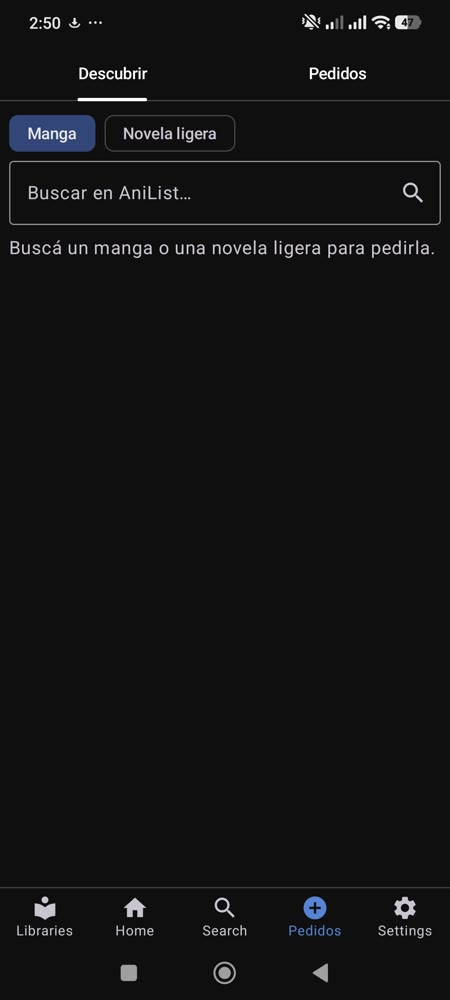

# Taberna Requests

A small self-hosted request manager for **manga and light novels** — think Seerr/Overseerr, but for your
[Komga](https://komga.org) library.

- **Discover:** search manga and light novels on [AniList](https://anilist.co) (alternative titles from
  MyAnimeList via [Jikan](https://jikan.moe)).
- **Request:** users sign in with their **Komga account** and request what they want to read.
- **Approve and choose a release:** admins (and users you allow) search your indexers through
  [Prowlarr](https://prowlarr.com) and send the chosen release to qBittorrent, in a `manga` or `novels` category.
- **Availability:** shows *Available* / *Partial 8/12* based on what is already in Komga.
- **Follow-ups:** ongoing series are re-checked daily; only releases with *new* volumes are grabbed automatically.
- **Per-user permissions:** auto-approve, choose releases, admin.

Release ranking prefers: title match → not unwanted (web novels, audiobooks, wrong kind) → seeders → missing
volumes → preferred language → complete packs → preferred format (EPUB/CBZ).

## Mobile app: Komelia Requests

**[Komelia Requests](https://github.com/CosoJs/Komelia-Requests)** is a fork of the Komelia reader for Android and
desktop with a built-in Requests tab that talks to this server. Your friends read in Komga *and* request new
titles from the same app.



It signs in with the Komga *remember-me* session the app already has: the server forwards that cookie only to your
configured Komga to find out who the user is (`POST /api/login` with `{"komga_remember_me": "..."}`) and returns a
session token that the app sends as the `X-Session` header. No password is stored by the app.

The app expects this server on the same host as Komga, at `/pedidos/` (`https://example.com/komga` →
`https://example.com/pedidos`), so use `"base_path": "/pedidos"` if you want the app to find it without changes.

## Requirements

- Python 3.8+ (standard library only, no `pip install` needed)
- Komga, Prowlarr and qBittorrent reachable from the server

## Setup

```bash
cp config.example.json config.json   # then edit it: URLs, Prowlarr API key, qBittorrent and Komga credentials
python3 test_app.py                   # self-test with fake services
python3 app.py config.json            # http://127.0.0.1:8787/
```

`config.json` and the SQLite database (`data.db`) hold secrets and user data and are git-ignored.

### Behind a reverse proxy

Set `"base_path": "/requests"` (or any path), `"secure_cookies": true`, keep `"host": "127.0.0.1"`, and proxy
`/requests/` to the app's port.

### As a service (systemd user unit)

```bash
cp taberna-requests.service ~/.config/systemd/user/
systemctl --user daemon-reload && systemctl --user enable --now taberna-requests
```

## Notes

- Language detection and volume ranges are parsed from release names, so they are hints, not guarantees.
- Download URLs from Prowlarr contain your API key; they are kept server-side and never sent to the browser.
- The UI is in Spanish.
